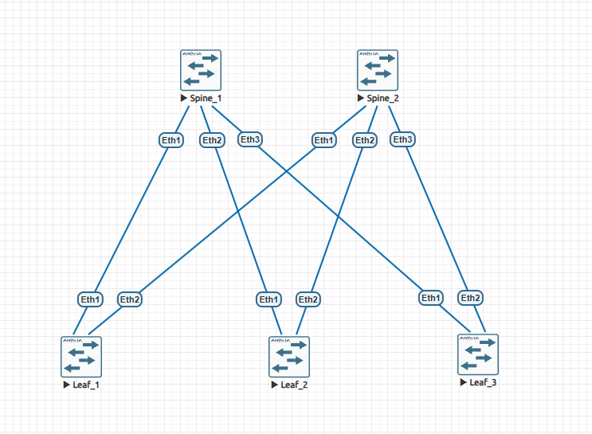
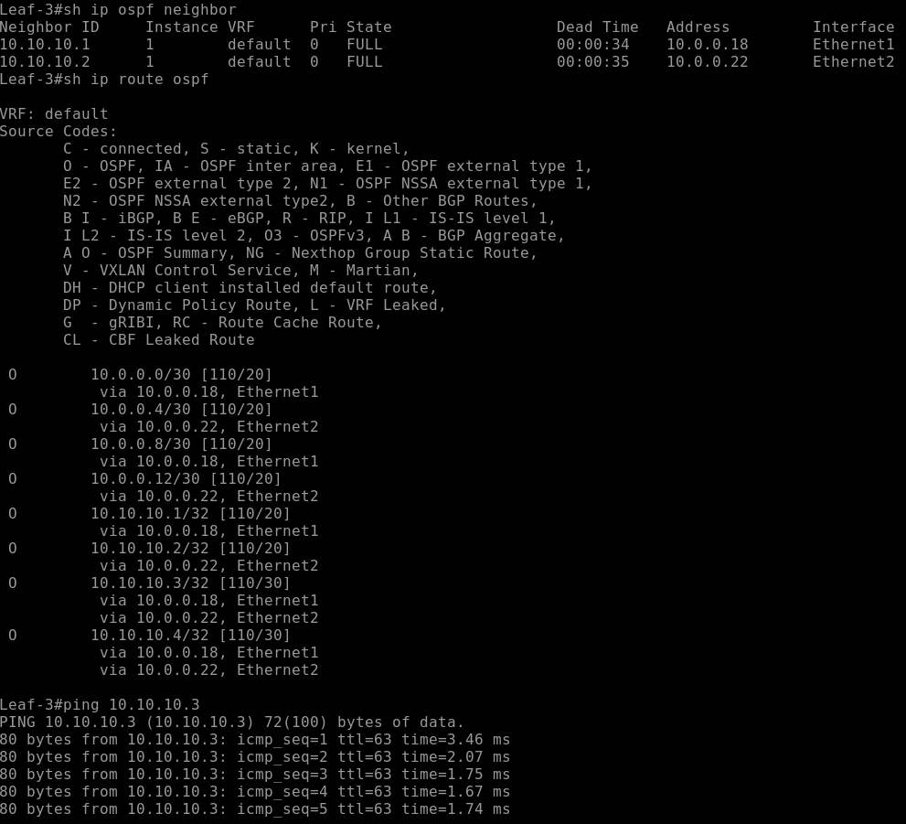
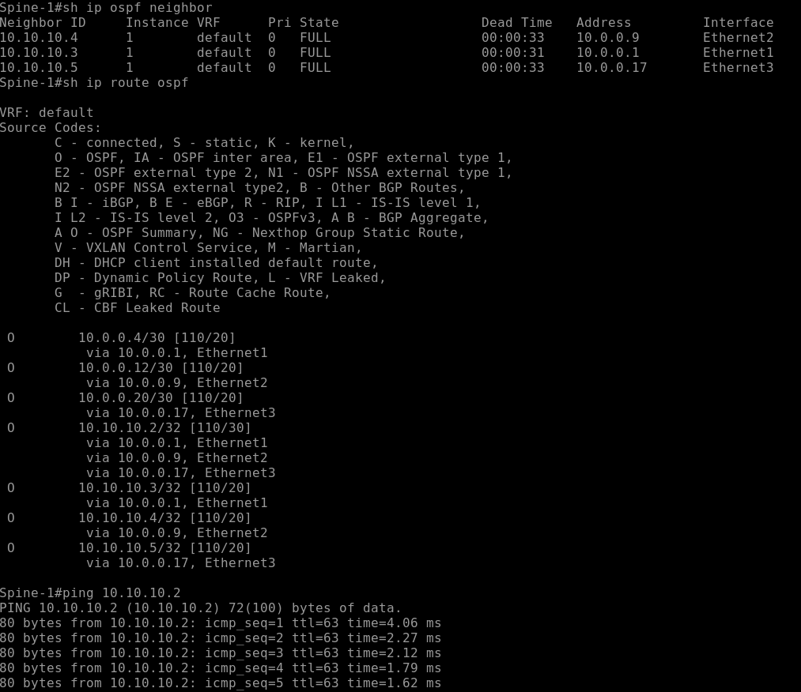

# Лабораторная работа №2. Настройка OSPF в CLOS-фабрике

## Цель

Настроить динамическую маршрутизацию OSPF в Underlay-сети CLOS, обеспечить обмен маршрутами между всеми коммутаторами и проверить IP-доступность Loopback-интерфейсов.

## Схема сети

Используется топология из первой лабораторной работы, собранная в EVE-NG на базе Arista vEOS (EOS 4.33.1.1F):

- 2 Spine-коммутатора;
- 3 Leaf-коммутатора;
- 6 L3 point-to-point соединений Leaf–Spine.



## Адресный план

Для транзитных соединений сохранён пул `10.0.0.0/24` с подсетями `/30`.

| Leaf | Интерфейс и адрес | Spine | Интерфейс и адрес | Подсеть |
|---|---|---|---|---|
| Leaf1 | Et1 — `10.0.0.1/30` | Spine1 | Et1 — `10.0.0.2/30` | `10.0.0.0/30` |
| Leaf1 | Et2 — `10.0.0.5/30` | Spine2 | Et1 — `10.0.0.6/30` | `10.0.0.4/30` |
| Leaf2 | Et1 — `10.0.0.9/30` | Spine1 | Et2 — `10.0.0.10/30` | `10.0.0.8/30` |
| Leaf2 | Et2 — `10.0.0.13/30` | Spine2 | Et2 — `10.0.0.14/30` | `10.0.0.12/30` |
| Leaf3 | Et1 — `10.0.0.17/30` | Spine1 | Et3 — `10.0.0.18/30` | `10.0.0.16/30` |
| Leaf3 | Et2 — `10.0.0.21/30` | Spine2 | Et3 — `10.0.0.22/30` | `10.0.0.20/30` |

Для Loopback-интерфейсов выделен отдельный пул `10.10.10.0/24`, адреса назначаются с маской `/32`.

| Устройство | Интерфейс | IP-адрес | OSPF Router ID |
|---|---|---|---|
| Spine1 | Loopback1 | `10.10.10.1/32` | `10.10.10.1` |
| Spine2 | Loopback0 | `10.10.10.2/32` | `10.10.10.2` |
| Leaf1 | Loopback1 | `10.10.10.3/32` | `10.10.10.3` |
| Leaf2 | Loopback1 | `10.10.10.4/32` | `10.10.10.4` |
| Leaf3 | Loopback1 | `10.10.10.5/32` | `10.10.10.5` |

Loopback-адреса используются как стабильные идентификаторы маршрутизаторов и для проверки маршрутизации между устройствами.

## План работ

1. Использовать топологию и транзитную адресацию из первой лабораторной.
2. Создать Loopback-интерфейсы и назначить адреса `/32`.
3. Включить IP-маршрутизацию на всех коммутаторах.
4. Настроить процесс OSPF 1 и назначить уникальные Router ID.
5. Включить OSPF area 0 на транзитных интерфейсах, указав тип сети `point-to-point`.
6. Добавить Loopback-интерфейсы в area 0.
7. Проверить соседства OSPF, полученные маршруты и доступность удалённых Loopback-адресов.

## Настройка OSPF

В качестве примера приведены команды для Leaf3:

```text
ip routing
!
interface Ethernet1
   no switchport
   ip address 10.0.0.17/30
   ip ospf network point-to-point
   ip ospf area 0.0.0.0
!
interface Ethernet2
   no switchport
   ip address 10.0.0.21/30
   ip ospf network point-to-point
   ip ospf area 0.0.0.0
!
interface Loopback1
   ip address 10.10.10.5/32
   ip ospf area 0.0.0.0
!
router ospf 1
   router-id 10.10.10.5
```

Все транзитные соединения включены в backbone area `0.0.0.0`. Тип OSPF-сети `point-to-point` выбран в соответствии с физической схемой, где на каждом линке находятся два маршрутизатора.

Полные конфигурации устройств приложены в директории `config/`.

## Проверка работоспособности

### OSPF-соседства

Команда проверки:

```text
show ip ospf neighbor
```

На Leaf3 установлены соседства с обоими Spine в состоянии `FULL`:

```text
Neighbor ID   State   Address     Interface
10.10.10.1    FULL    10.0.0.18   Ethernet1
10.10.10.2    FULL    10.0.0.22   Ethernet2
```

На Spine1 установлены соседства с тремя Leaf в состоянии `FULL`:

```text
Neighbor ID   State   Address     Interface
10.10.10.4    FULL    10.0.0.9    Ethernet2
10.10.10.3    FULL    10.0.0.1    Ethernet1
10.10.10.5    FULL    10.0.0.17   Ethernet3
```

### Маршруты OSPF

Команда проверки:

```text
show ip route ospf
```

На Leaf3 получены маршруты к удалённым транзитным подсетям и Loopback-адресам, включая ранее отсутствовавший маршрут `10.10.10.4/32` (Leaf2). Например, маршрут к `10.10.10.3/32` доступен через два равнозначных next-hop:

```text
O 10.10.10.3/32 [110/30]
  via 10.0.0.18, Ethernet1
  via 10.0.0.22, Ethernet2
```

Это подтверждает наличие двух равностоимостных путей через Spine1 и Spine2 (ECMP). После включения Loopback1 устройства Leaf2 в OSPF маршрут `10.10.10.4/32` также появился через оба Spine.

### ICMP-проверки

С Leaf3 проверена доступность Loopback-адреса Leaf1:

```text
Leaf-3# ping 10.10.10.3
5 packets transmitted, 5 received, 0% packet loss
```

Со Spine1 проверена доступность Loopback-адреса Spine2:

```text
Spine-1# ping 10.10.10.2
5 packets transmitted, 5 received, 0% packet loss
```

### Скриншоты

**Leaf3 — соседства, маршруты и ping:**



**Spine1 — соседства, маршруты и ping:**



## Результат

На CLOS-топологии из двух Spine и трёх Leaf настроен OSPF в backbone area 0. Созданы Loopback-интерфейсы, включена L3-маршрутизация и настроены OSPF-соседства на транзитных соединениях.

По результатам проверок на Leaf3 и Spine1 соседства находятся в состоянии `FULL`, удалённые маршруты присутствуют в таблицах маршрутизации, ICMP-проверки завершились без потерь. Для части маршрутов доступны равностоимостные пути через оба Spine.

Дополнительно проверено распространение Loopback-адреса Leaf2 (`10.10.10.4/32`): после корректировки конфигурации маршрут присутствует на Leaf3 и Spine1.
