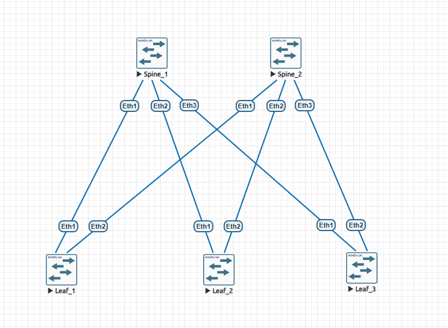
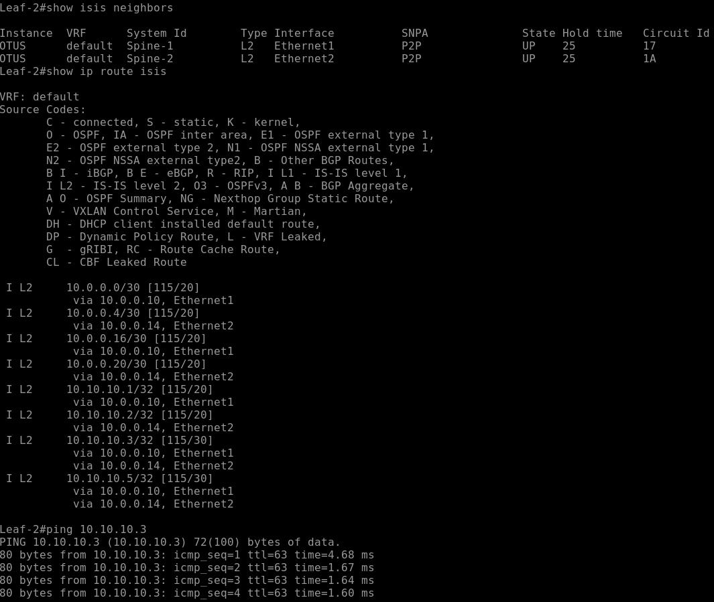
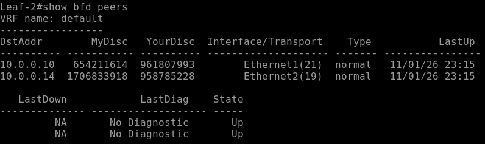
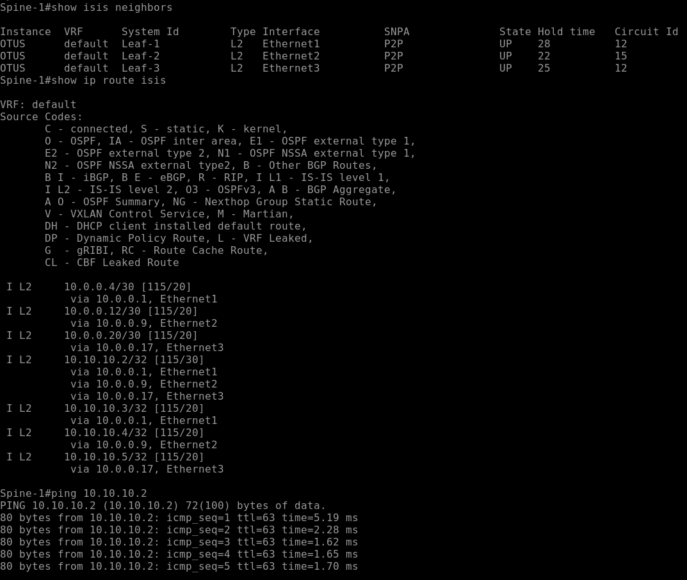
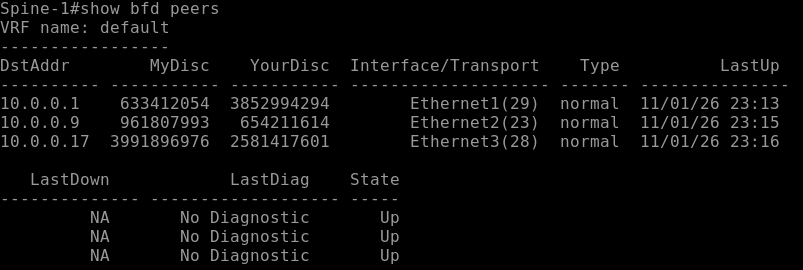

# Лабораторная работа №3. IS-IS Underlay и BFD в фабрике Spine–Leaf

## Цель работы

Развернуть маршрутизацию Underlay на базе **IS-IS Level-2** в фабрике Clos (2 Spine и 3 Leaf), обеспечить распространение Loopback-адресов, проверить формирование соседств и маршрутов, а также настроить **BFD** для быстрого обнаружения потери связности на транзитных соединениях.

## Лабораторная среда

- Платформа: EVE-NG, Arista vEOS-lab, EOS 4.33.1.1F.
- Топология: 2 Spine, 3 Leaf, 6 соединений Spine–Leaf.
- Протокол Underlay: IS-IS, процесс `OTUS`, Level-2 only.
- BFD: включён на транзитных интерфейсах.

## Топология

Каждый Leaf подключён к обоим Spine. Прямых соединений Spine–Spine и Leaf–Leaf нет.



## План IP-адресации

Для транзитных соединений выделен пул `10.0.0.0/24`, разделённый на подсети `/30`. Для идентификации маршрутизаторов и проверки маршрутизации используются адреса Loopback1 `/32`.

| Соединение | Интерфейс Spine | Адрес Spine | Интерфейс Leaf | Адрес Leaf | Подсеть |
|---|---|---|---|---|---|
| Spine-1 — Leaf-1 | Ethernet1 | 10.0.0.2/30 | Ethernet1 | 10.0.0.1/30 | 10.0.0.0/30 |
| Spine-2 — Leaf-1 | Ethernet1 | 10.0.0.6/30 | Ethernet2 | 10.0.0.5/30 | 10.0.0.4/30 |
| Spine-1 — Leaf-2 | Ethernet2 | 10.0.0.10/30 | Ethernet1 | 10.0.0.9/30 | 10.0.0.8/30 |
| Spine-2 — Leaf-2 | Ethernet2 | 10.0.0.14/30 | Ethernet2 | 10.0.0.13/30 | 10.0.0.12/30 |
| Spine-1 — Leaf-3 | Ethernet3 | 10.0.0.18/30 | Ethernet1 | 10.0.0.17/30 | 10.0.0.16/30 |
| Spine-2 — Leaf-3 | Ethernet3 | 10.0.0.22/30 | Ethernet2 | 10.0.0.21/30 | 10.0.0.20/30 |

| Устройство | Loopback1 | NET IS-IS |
|---|---|---|
| Spine-1 | 10.10.10.1/32 | `49.0001.0000.0000.0001.00` |
| Spine-2 | 10.10.10.2/32 | `49.0001.0000.0000.0002.00` |
| Leaf-1 | 10.10.10.3/32 | `49.0001.0000.0000.0003.00` |
| Leaf-2 | 10.10.10.4/32 | `49.0001.0000.0000.0004.00` |
| Leaf-3 | 10.10.10.5/32 | `49.0001.0000.0000.0005.00` |

## Выбранные решения

**IS-IS Level-2 only.** Все пять маршрутизаторов работают на одном уровне IS-IS. Разделение на Spine и Leaf задаётся топологией.

**Point-to-point на транзитных интерфейсах.** Все шесть соединений являются двухточечными.

**Passive Loopback1.** Loopback участвует в маршрутизации и анонсируется, но на нём не формируются соседства.

**BFD для IS-IS.** BFD контролирует доступность соседа и уведомляет IS-IS об отказе. При параметрах `300/300/3` расчётное время обнаружения прекращения обмена BFD-пакетами составляет 900 мс.

## Ход выполнения

### 1. Подготовка лаборатории

В EVE-NG развернута топология Clos из пяти коммутаторов Arista vEOS: двух Spine и трёх Leaf. Настроены шесть L3-соединений Spine–Leaf с адресацией /30, интерфейсы Loopback1 с адресами /32 и включена IPv4-маршрутизация (`ip routing`).

### 2. Настройка IS-IS

На всех коммутаторах создан процесс IS-IS `OTUS`, задан уникальный NET, включён Level-2 и IPv4 unicast. IS-IS активирован на интерфейсах Spine–Leaf в режиме point-to-point и на Loopback1 в пассивном режиме.

Пример конфигурации **Leaf-1**:

```text
router isis OTUS
   net 49.0001.0000.0000.0003.00
   is-type level-2
   address-family ipv4 unicast
!
interface Ethernet1
   description Spine1
   no switchport
   ip address 10.0.0.1/30
   isis enable OTUS
   isis bfd
   isis network point-to-point
!
interface Ethernet2
   description Spine2
   no switchport
   ip address 10.0.0.5/30
   isis enable OTUS
   isis bfd
   isis network point-to-point
!
interface Loopback1
   ip address 10.10.10.3/32
   isis enable OTUS
   isis passive
!
ip routing
```

Полные конфигурации всех пяти устройств приложены в каталоге [`config/`](config/).

### 3. Настройка BFD

BFD включён на всех шести транзитных соединениях. В сохранённых `show running-config` на всех транзитных интерфейсах присутствует команда `isis bfd` (пример для Ethernet1):

```text
interface Ethernet1
   isis bfd
```

Команда `isis bfd` связывает BFD-сессию с IS-IS на соответствующем интерфейсе. Фактические параметры 300/300/3 подтверждены выводом `show bfd peers detail` на Spine-1.

## Проверка работоспособности

### Соседства IS-IS

На Spine-1 команда `show isis neighbors` показала три соседства Level-2 в состоянии `UP`:

| Сосед | Интерфейс | Тип | Состояние |
|---|---|---|---|
| Leaf-1 | Ethernet1 | L2 P2P | UP |
| Leaf-2 | Ethernet2 | L2 P2P | UP |
| Leaf-3 | Ethernet3 | L2 P2P | UP |

Аналогично, на Spine-2 были обнаружены все три Leaf в состоянии `UP`.

### Маршруты IS-IS и ECMP

На Spine-2 команда `show ip route isis` показала маршруты ко всем удалённым Loopback. В частности, до Loopback Spine-1 `10.10.10.1/32` обнаружены три равнозначных пути:

```text
I L2  10.10.10.1/32 [115/30]
      via 10.0.0.5, Ethernet1
      via 10.0.0.13, Ethernet2
      via 10.0.0.21, Ethernet3
```

Это подтверждает наличие ECMP-маршрутов через Leaf-1, Leaf-2 и Leaf-3. В записи `[115/30]` число 115 — административная дистанция, 30 — метрика IS-IS.

### Проверка на Leaf-2

На Leaf-2 подтверждены два IS-IS-соседства Level-2 (`Spine-1` и `Spine-2`) и две BFD-сессии в состоянии `Up` (10.0.0.10 и 10.0.0.14). Маршруты к Loopback Leaf-1 (`10.10.10.3/32`) и Leaf-3 (`10.10.10.5/32`) установлены с двумя равнозначными next-hop через оба Spine. Пинг `10.10.10.3` успешен.





### BFD-сессии

На Spine-1 команда `show bfd peers` показала три сессии в состоянии `Up`:

| Адрес соседа | Интерфейс | Состояние |
|---|---|---|
| 10.0.0.1 | Ethernet1 | Up |
| 10.0.0.9 | Ethernet2 | Up |
| 10.0.0.17 | Ethernet3 | Up |

В `show bfd peers detail` подтверждены:

```text
TxInt: 300 ms, RxInt: 300 ms, Multiplier: 3
Detect Time: 900 ms
Registered protocols: isis
Hardware Acceleration: Async Off, Echo Off
```

Таким образом, BFD-сессии работают и IS-IS зарегистрирован как клиент BFD. 





На Spine-1 также подтверждён успешный пинг Loopback Spine-2 (`10.10.10.2`).

## Команды диагностики

```text
show isis neighbors
show isis interface
show ip route isis
show isis database detail
show bfd peers
show bfd peers detail
show running-config
```

## Результат и выводы

1. На пяти виртуальных коммутаторах Arista развернута фабрика Clos с Underlay на IS-IS Level-2.
2. Установлены соседства IS-IS на транзитных линках; на обоих Spine подтверждены соседства со всеми тремя Leaf.
3. На Spine-2 подтверждено получение маршрутов к Loopback-адресам и наличие трёх равнозначных путей до Loopback Spine-1.
4. BFD настроен на всех транзитных соединениях; на Spine-1 проверены три работающие сессии и их привязка к IS-IS.

## Файлы лабораторной

```text
lab03/
├── README.md
├── topology.png
├── config/
│   ├── Spine1.txt
│   ├── Spine2.txt
│   ├── Leaf1.txt
│   ├── Leaf2.txt
│   └── Leaf3.txt
└── screenshots/
    ├── Spine1_ISIS.png
    ├── Spine1_BFD.png
    ├── Leaf2_ISIS.png
    └── Leaf2_BFD.png
```

