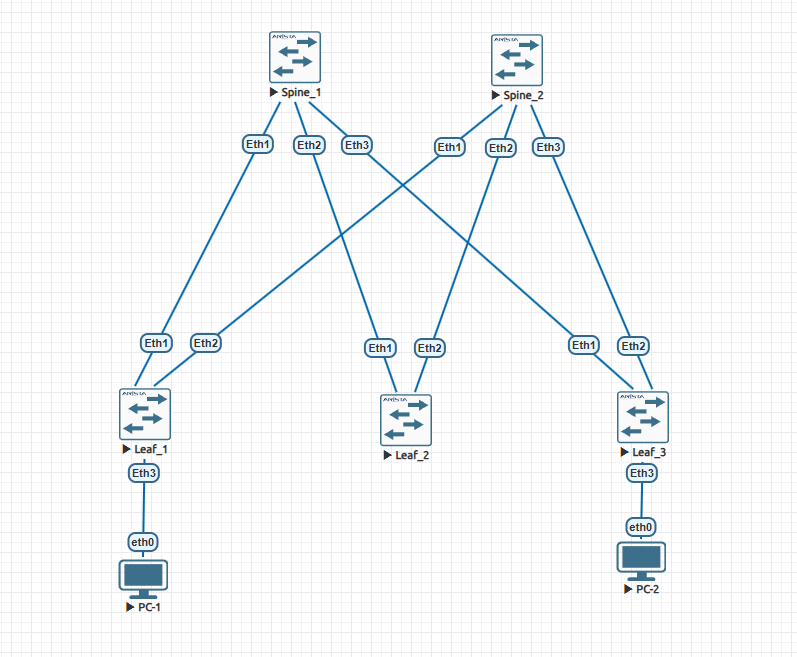
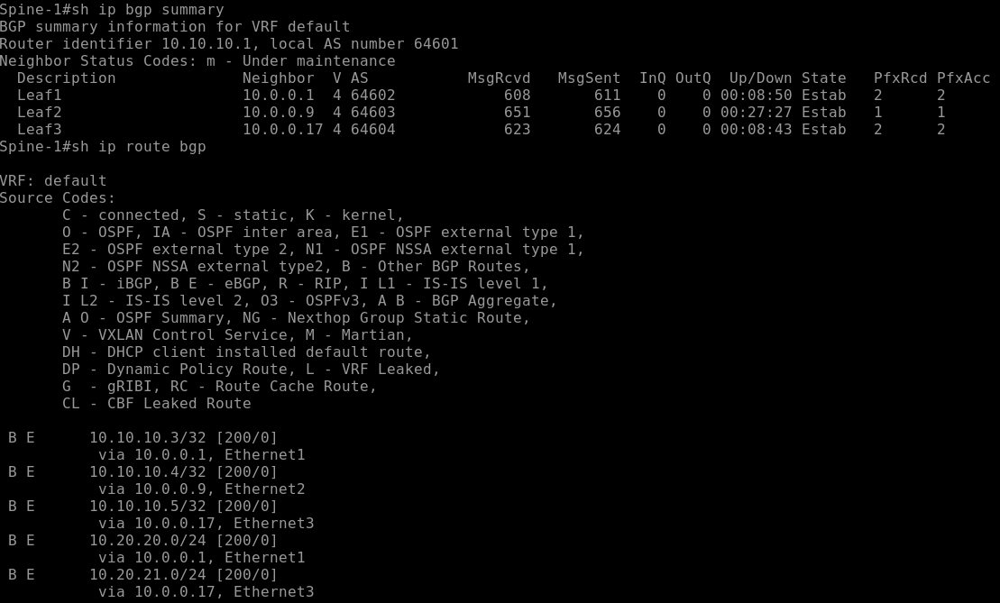
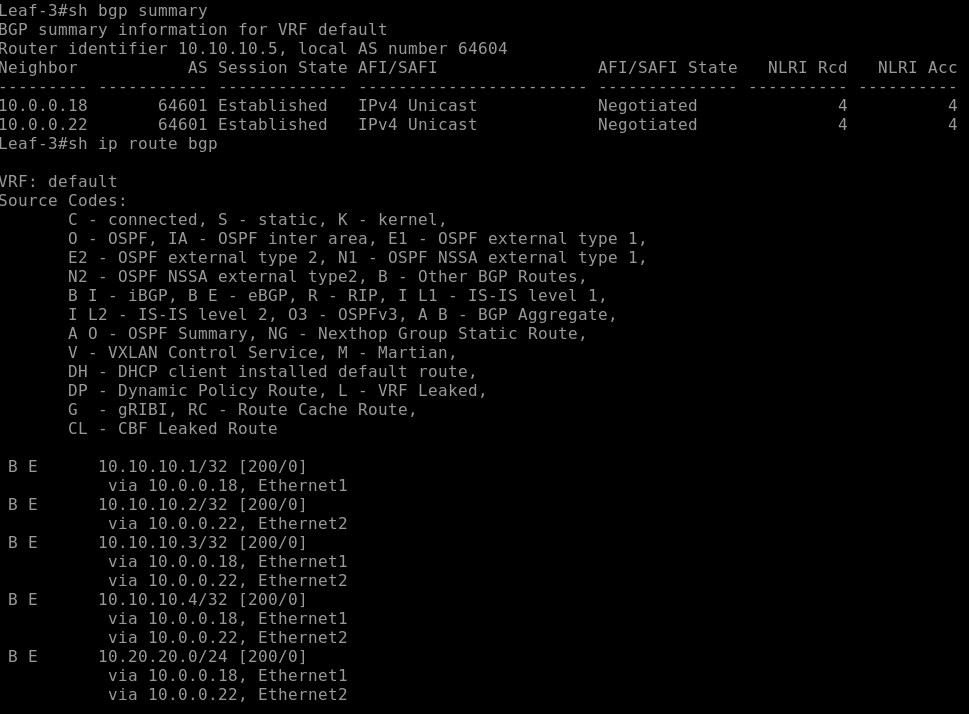
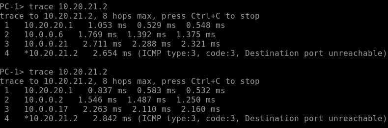
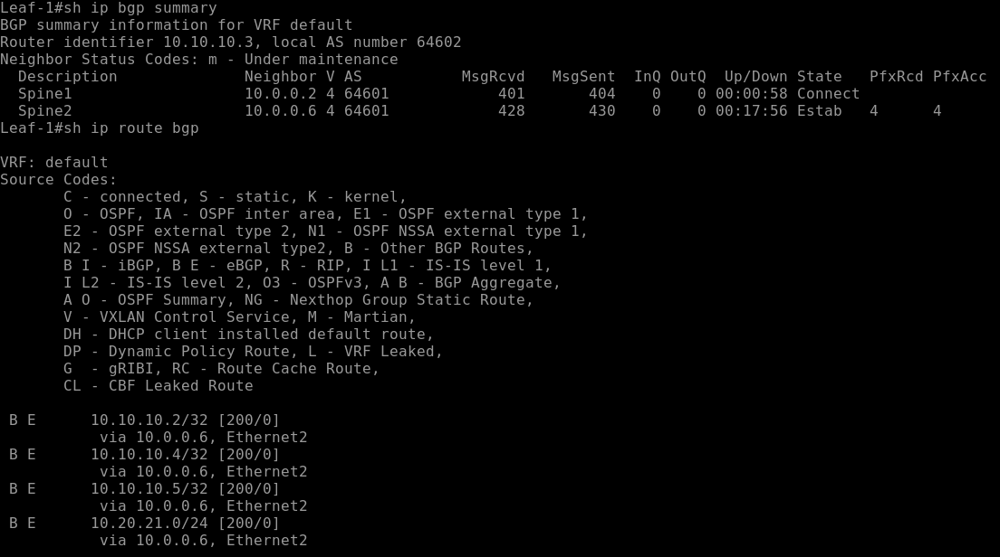
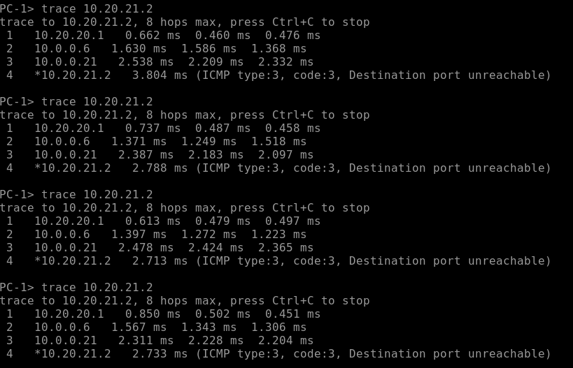

# Лабораторная работа №4. Построение Underlay-сети с использованием eBGP

## 1. Цель работы

Построить Underlay-сеть на основе двухуровневой топологии Clos с использованием протокола eBGP.

В рамках лабораторной работы необходимо:
- Настроить eBGP-соседства между Spine и Leaf.
- Организовать распространение подключённых сетей с фильтрацией транзитных подсетей.
- Настроить ECMP для балансировки трафика между Spine.
- Настроить BFD для ускоренного обнаружения отказов.
- Проверить IP-связность конечных устройств.
- Проверить отказоустойчивость при отключении одного Spine.

## 2. Топология сети

В лабораторной работе используется виртуальная среда EVE-NG и пять коммутаторов **Arista vEOS-lab 4.33.1.1F**.

Топология построена по схеме Clos и включает два Spine, три Leaf и два конечных устройства VPCS. Каждый Leaf подключён к обоим Spine по отдельным L3-соединениям. Конечные устройства подключены к Leaf-1 и Leaf-3.



### План адресации и автономных систем

| Устройство | ASN | Loopback |
|---|---:|---|
| Spine-1 | 64601 | 10.10.10.1/32 |
| Spine-2 | 64601 | 10.10.10.2/32 |
| Leaf-1 | 64602 | 10.10.10.3/32 |
| Leaf-2 | 64603 | 10.10.10.4/32 |
| Leaf-3 | 64604 | 10.10.10.5/32 |

Оба Spine используют одну автономную систему AS 64601, каждый Leaf имеет собственный ASN.

Для транзитных соединений используется адресное пространство `10.0.0.0/24`, разделённое на подсети `/30`.

Для проверки связности настроены две пользовательские сети:

| Устройство | Сеть | Шлюз | IP компьютера |
|---|---|---|---|
| Leaf-1 / PC-1 | 10.20.20.0/24 | 10.20.20.1 | 10.20.20.2 |
| Leaf-3 / PC-2 | 10.20.21.0/24 | 10.20.21.1 | 10.20.21.2 |

## 3. Настройка Underlay

### 3.1. Настройка eBGP

На всех коммутаторах настроен BGP с использованием соответствующих ASN.

Для упрощения конфигурации применены Peer Groups: `LEAFS` на Spine и `SPINE` на Leaf.

Пример конфигурации Spine-1:

```text
router bgp 64601
   router-id 10.10.10.1
   maximum-paths 3
   neighbor LEAFS peer group
   neighbor LEAFS bfd
   neighbor LEAFS timers 3 9
   neighbor 10.0.0.1 peer group LEAFS
   neighbor 10.0.0.1 remote-as 64602
   neighbor 10.0.0.9 peer group LEAFS
   neighbor 10.0.0.9 remote-as 64603
   neighbor 10.0.0.17 peer group LEAFS
   neighbor 10.0.0.17 remote-as 64604
   !
   address-family ipv4
      neighbor LEAFS activate
      redistribute connected route-map RM_FROM_CONNECTED_BGP
```

На Leaf аналогично настроены eBGP-соседства с обоими Spine. Для балансировки трафика используется `maximum-paths 2 ecmp 2`.

Полные конфигурации коммутаторов находятся в каталоге [`configs/`](configs/).

### 3.2. Распространение маршрутов

Для распространения подключённых сетей используется `redistribute connected` с фильтрацией через prefix-list и route-map.

```text
ip prefix-list RM_FROM_CONNECTED seq 10 deny 10.0.0.0/24 le 32
ip prefix-list RM_FROM_CONNECTED seq 20 permit 0.0.0.0/0 le 32
!
route-map RM_FROM_CONNECTED_BGP permit 10
   match ip address prefix-list RM_FROM_CONNECTED
```

Фильтрация исключает транзитные подсети из BGP-анонсов, при этом Loopback и пользовательские сети распространяются автоматически.

### 3.3. BFD

Для BGP-соседств включён BFD:

```text
neighbor LEAFS bfd
```

На Leaf используется аналогичная команда для Peer Group `SPINE`.

BFD предназначен для ускоренного обнаружения отказов соединений.

## 4. Проверка работоспособности

### 4.1. Проверка BGP-соседств

После настройки eBGP-соседства между Spine и Leaf установились успешно.

На Spine-1 все три соседства находятся в состоянии `Established`, маршруты Loopback и пользовательских сетей получены через BGP.



На Leaf-3 установлены два BGP-соседства с Spine-1 и Spine-2. Маршруты до удалённых Loopback и пользовательской сети `10.20.20.0/24` получены через оба Spine.



### 4.2. Проверка ECMP

Для проверки балансировки трафика выполнены трассировки с PC-1 (`10.20.20.2`) до PC-2 (`10.20.21.2`).

Получены два варианта маршрута:

- **Через Spine-1:** PC-1 → Leaf-1 → Spine-1 → Leaf-3 → PC-2.
- **Через Spine-2:** PC-1 → Leaf-1 → Spine-2 → Leaf-3 → PC-2.

Это подтверждает использование обоих равнозначных маршрутов между Leaf-1 и Leaf-3.



## 5. Проверка отказоустойчивости

Для проверки отказоустойчивости выполнено отключение Spine-1 в среде EVE-NG.

После отключения на Leaf-1:
- BGP-соседство с Spine-1 перешло в состояние `Connect`.
- BGP-соседство со Spine-2 осталось в состоянии `Established`.
- Маршруты через Spine-1 были удалены из таблицы маршрутизации.
- Маршрут до пользовательской сети `10.20.21.0/24` сохранился через Spine-2.



Повторные трассировки PC-1 → PC-2 показали прохождение трафика исключительно через Spine-2:

```text
PC-1 → Leaf-1 → Spine-2 → Leaf-3 → PC-2
```



Связность конечных устройств сохранилась. Это подтверждает работоспособность резервирования маршрутов при отказе одного Spine.

## 6. Вывод

В ходе лабораторной работы построена двухуровневая Clos-сеть с использованием eBGP в качестве протокола Underlay-маршрутизации.

Настроены BGP-соседства, распространение подключённых сетей с исключением транзитных подсетей, ECMP и BFD.

Проверена маршрутизация между конечными устройствами через оба Spine. При отключении Spine-1 трафик продолжил передаваться через Spine-2 без ручного изменения маршрутов.

**В результате подтверждена работоспособность eBGP Underlay, балансировки ECMP и отказоустойчивости построенной сети.**
