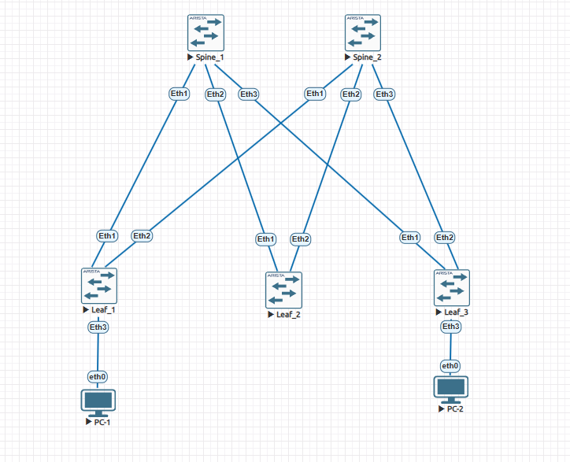
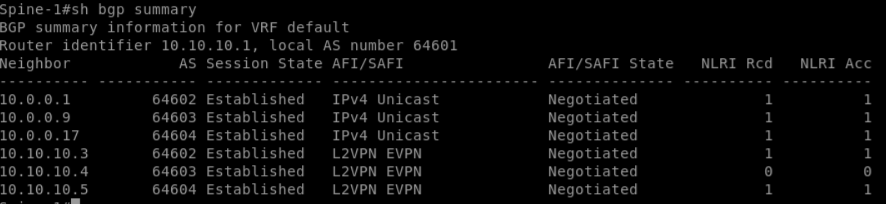
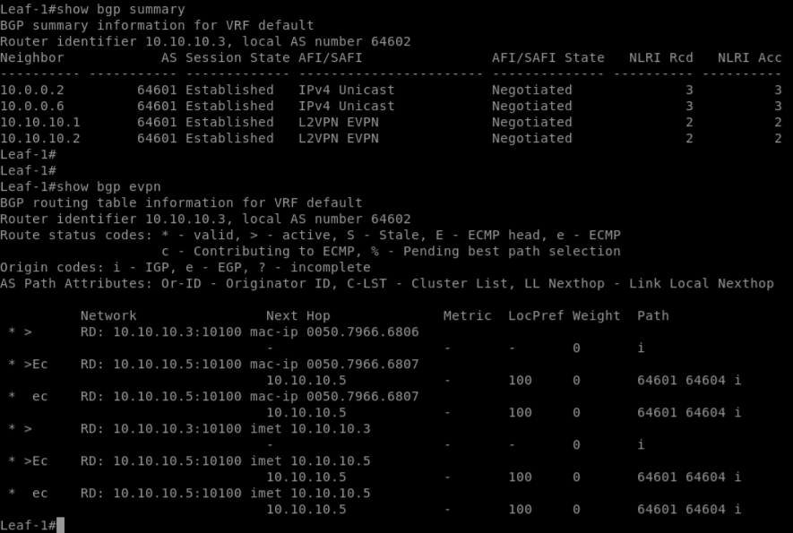
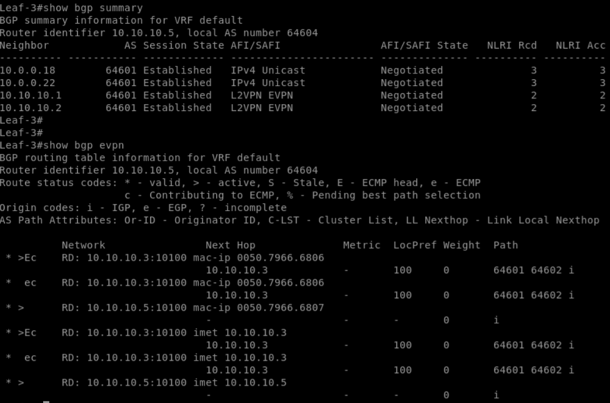
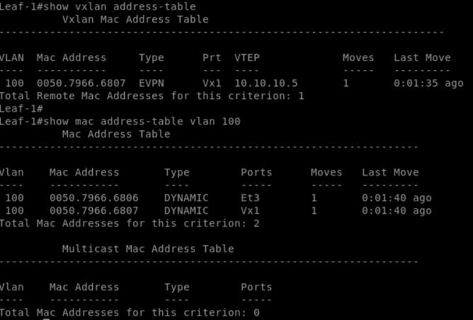
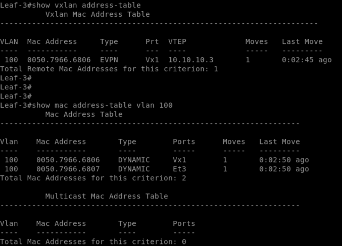
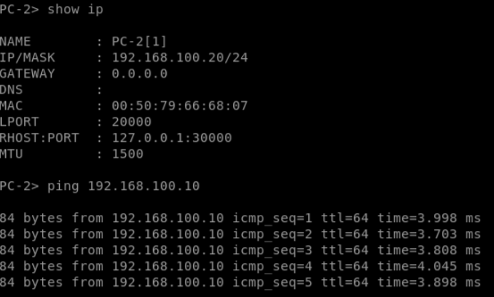

# Лабораторная работа №5. VXLAN EVPN L2

## 1. Цель работы

Настроить VXLAN Overlay с использованием BGP EVPN для обеспечения L2-связности между клиентами, подключёнными к разным Leaf-коммутаторам в архитектуре Spine–Leaf.

Задачи:
- Настроить BGP EVPN-соседства между Leaf и Spine.
- Создать L2 VNI и обеспечить передачу Ethernet-трафика через VXLAN.
- Проверить распространение EVPN-маршрутов Type-2 и Type-3.
- Подтвердить связность между клиентами.
- Задокументировать конфигурацию и результаты проверки.

## 2. Топология сети

Используется топология Clos: два Spine и три Leaf-коммутатора Arista vEOS. Каждый Leaf подключён к обоим Spine по отдельным L3-соединениям.

- PC-1 подключён к Ethernet3 коммутатора Leaf-1.
- PC-2 подключён к Ethernet3 коммутатора Leaf-3.

## 3. План адресации

### 3.1. Loopback-адреса и автономные системы

| Устройство | Loopback IP | ASN |
|---|---|---|
| Spine-1 | 10.10.10.1/32 | 64601 |
| Spine-2 | 10.10.10.2/32 | 64601 |
| Leaf-1 | 10.10.10.3/32 | 64602 |
| Leaf-2 | 10.10.10.4/32 | 64603 |
| Leaf-3 | 10.10.10.5/32 | 64604 |

Loopback-адреса используются для установления BGP EVPN-соседств.

### 3.2. Физические Underlay-соединения

| Соединение | Интерфейс Leaf | IP Leaf | Интерфейс Spine | IP Spine |
|---|---|---|---|---|
| Leaf-1 — Spine-1 | Ethernet1 | 10.0.0.1/30 | Ethernet1 | 10.0.0.2/30 |
| Leaf-1 — Spine-2 | Ethernet2 | 10.0.0.5/30 | Ethernet1 | 10.0.0.6/30 |
| Leaf-2 — Spine-1 | Ethernet1 | 10.0.0.9/30 | Ethernet2 | 10.0.0.10/30 |
| Leaf-2 — Spine-2 | Ethernet2 | 10.0.0.13/30 | Ethernet2 | 10.0.0.14/30 |
| Leaf-3 — Spine-1 | Ethernet1 | 10.0.0.17/30 | Ethernet3 | 10.0.0.18/30 |
| Leaf-3 — Spine-2 | Ethernet2 | 10.0.0.21/30 | Ethernet3 | 10.0.0.22/30 |

### 3.3. VXLAN-сегмент

| Параметр | Значение |
|---|---|
| VLAN | 100 |
| L2 VNI | 10100 |
| Route Target | 64600:10100 |
| RD Leaf-1 | 10.10.10.3:10100 |
| RD Leaf-3 | 10.10.10.5:10100 |
| VTEP Leaf-1 | 10.10.10.3 |
| VTEP Leaf-3 | 10.10.10.5 |
| VXLAN UDP Port | 4789 |

### 3.4. Адресация клиентов

| Клиент | IP-адрес | Подключение |
|---|---|---|
| PC-1 | 192.168.100.10/24 | Leaf-1, Ethernet3 |
| PC-2 | 192.168.100.20/24 | Leaf-3, Ethernet3 |

Шлюз по умолчанию не используется, поскольку оба клиента находятся в одной IP-подсети.

## 4. Настройка сети

### 4.1. Underlay

В качестве Underlay используется eBGP. Все Leaf имеют BGP-соседства с обоими Spine; маршрутизация обеспечивает IP-доступность Loopback-адресов устройств. Для передачи трафика доступны пути через Spine-1 и Spine-2.

### 4.2. BGP EVPN Overlay

Между Loopback-адресами Leaf и Spine настроены отдельные eBGP-соседства в Address Family `L2VPN EVPN`.

Для Overlay-соседств используются `update-source`, `ebgp-multihop 5`, передача Extended Communities и активация EVPN AF. IPv4 Unicast для Overlay-соседств отключён.

На Spine настроены сохранение исходного BGP NEXT_HOP при передаче EVPN-маршрутов и `retain route-target all`. Всего установлено шесть EVPN-соседств: каждый из трёх Leaf подключён к обоим Spine.

### 4.3. Настройка VXLAN

На Leaf-1 и Leaf-3 созданы VLAN 100 и интерфейс `Vxlan1`. Локальный VLAN 100 сопоставлен с L2 VNI 10100, в качестве VTEP IP используются Loopback-адреса соответствующих Leaf.

Для VLAN 100 настроены уникальные RD и общий RT `64600:10100`. Локально изученные MAC-адреса объявляются через BGP EVPN.

Для BUM-трафика используется Head-End Replication; список удалённых VTEP формируется на основании EVPN-маршрутов Type-3. Клиентские интерфейсы Ethernet3 на Leaf-1 и Leaf-3 работают в режиме Access VLAN 100.

## 5. Проверка работоспособности

### 5.1. Проверка BGP EVPN

На Spine-1 подтверждено состояние `Established` для трёх EVPN-соседств. На Leaf-1 и Leaf-3 также подтверждена работа IPv4 Unicast Underlay и L2VPN EVPN Overlay.

### 5.2. Проверка EVPN-маршрутов

На Leaf-1 и Leaf-3 обнаружены маршруты:

- **Type-2 (MAC/IP Advertisement)** — распространение MAC-адресов клиентов.
- **Type-3 (IMET)** — обнаружение VTEP, участвующих в L2-сегменте.

Маршруты от удалённых Leaf поступают через оба Spine. BGP NEXT_HOP при этом сохраняет адрес исходного VTEP. Например, на Leaf-1 MAC-адрес PC-2 `0050.7966.6807` доступен через VTEP `10.10.10.5`.

### 5.3. Проверка MAC-таблиц

**Leaf-1:**

| MAC-адрес | Интерфейс | Расположение |
|---|---|---|
| 0050.7966.6806 | Ethernet3 | Локальный PC-1 |
| 0050.7966.6807 | Vxlan1 | Удалённый PC-2 |

**Leaf-3:**

| MAC-адрес | Интерфейс | Расположение |
|---|---|---|
| 0050.7966.6806 | Vxlan1 | Удалённый PC-1 |
| 0050.7966.6807 | Ethernet3 | Локальный PC-2 |

Удалённые MAC-адреса изучаются через EVPN; VXLAN Address Table содержит соответствия удалённых MAC-адресов и VTEP.

### 5.4. Проверка связности клиентов

Выполнена проверка ICMP между PC-1 и PC-2.

| Направление | Результат |
|---|---|
| PC-1 → PC-2 | Успешно |
| PC-2 → PC-1 | Успешно |

Оба клиента находятся в одной подсети `192.168.100.0/24`, но подключены к разным Leaf-коммутаторам. Двусторонний ICMP-обмен подтверждает работоспособность L2-связности через VXLAN Overlay.

## 6. Конфигурации устройств

- [Spine-1](configs/Spine1.txt)
- [Spine-2](configs/Spine2.txt)
- [Leaf-1](configs/Leaf1.txt)
- [Leaf-2](configs/Leaf2.txt)
- [Leaf-3](configs/Leaf3.txt)

## 7. Вывод

В ходе лабораторной работы настроен VXLAN EVPN Overlay поверх Spine–Leaf Underlay-сети.

Реализованы BGP EVPN-соседства между всеми Leaf и Spine, создан L2 VNI 10100 и обеспечена связность между клиентами, подключёнными к разным Leaf-коммутаторам.

Проверены распространение EVPN-маршрутов Type-2 и Type-3, изучение удалённых MAC-адресов и сохранение VTEP NEXT_HOP при передаче маршрутов через Spine.

Успешный двусторонний ICMP-обмен подтвердил работоспособность L2 VXLAN-сегмента без использования L3-шлюза.
