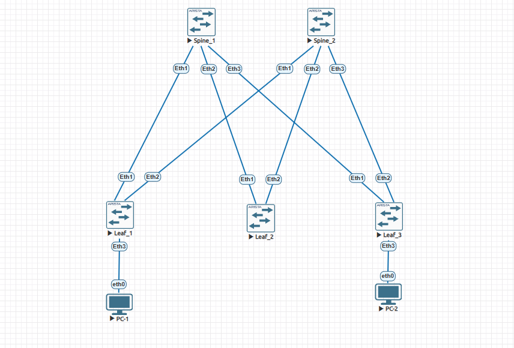
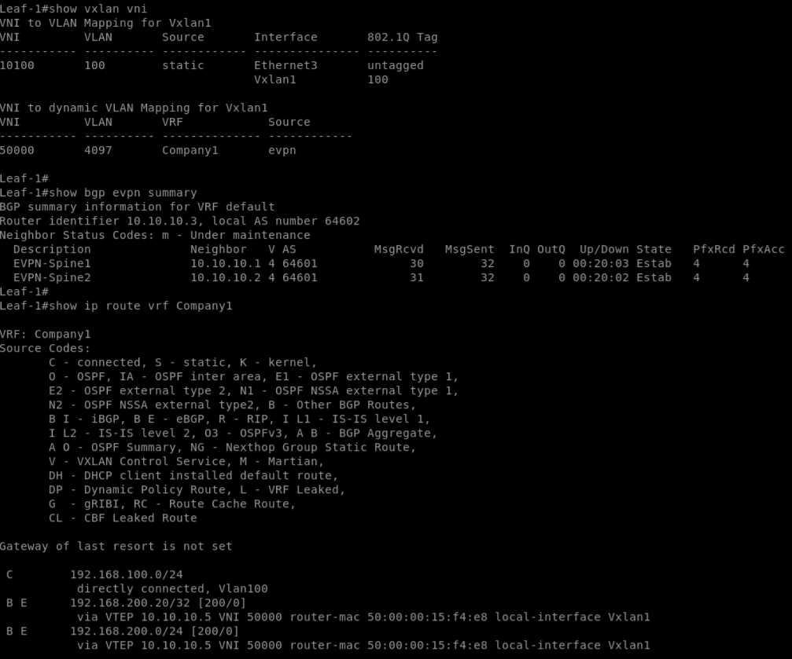
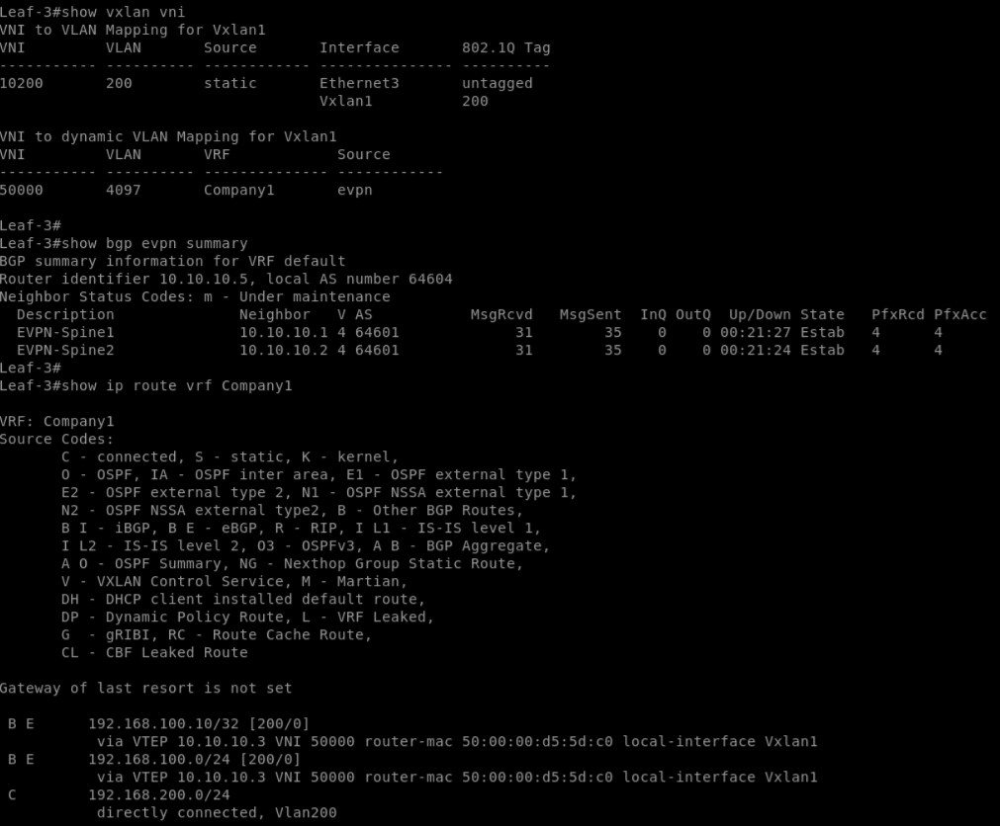
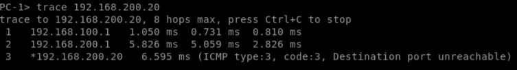

# Lab 06 — EVPN VXLAN L3 (Symmetric IRB)

## Цель работы

Настроить межсетевую маршрутизацию между различными VLAN через EVPN VXLAN с использованием Symmetric IRB.

В рамках работы необходимо:

- Создать отдельный VRF для клиентских сетей.
- Настроить L3VNI для маршрутизации между VTEP.
- Настроить виртуальные шлюзы для клиентских VLAN.
- Организовать распространение IP-префиксов через BGP EVPN.
- Проверить связность между устройствами из разных подсетей.

## 1. Топология



Используется фабрика Clos из двух Spine и трёх Leaf на базе Arista vEOS 4.33.1.1F.

За основу взята топология и конфигурация Lab 05, в которой уже были настроены eBGP Underlay и BGP EVPN Overlay. В данной лабораторной реализована L3-маршрутизация между клиентскими VLAN.

### Адресация

| Устройство | Loopback / IP | AS |
|---|---|---|
| Spine-1 | 10.10.10.1 | 64601 |
| Spine-2 | 10.10.10.2 | 64601 |
| Leaf-1 | 10.10.10.3 | 64602 |
| Leaf-2 | 10.10.10.4 | 64603 |
| Leaf-3 | 10.10.10.5 | 64604 |

### Клиентские сети

| Параметр | Leaf-1 | Leaf-3 |
|---|---|---|
| VLAN | 100 | 200 |
| L2VNI | 10100 | 10200 |
| VRF | Company1 | Company1 |
| L3VNI | 50000 | 50000 |
| Gateway | 192.168.100.1/24 | 192.168.200.1/24 |
| Клиент | PC-1 | PC-2 |
| IP клиента | 192.168.100.10/24 | 192.168.200.20/24 |

## 2. Настройка L3 VXLAN

На Leaf-1 и Leaf-3 создан VRF `Company1` и включена IPv4-маршрутизация:

```text
vrf instance Company1
ip routing vrf Company1
```

Для передачи маршрутизируемого трафика между Leaf VRF привязан к общему L3VNI:

```text
interface Vxlan1
   vxlan vrf Company1 vni 50000
```

### Виртуальные шлюзы

**Leaf-1:**

```text
interface Vlan100
   vrf Company1
   ip address virtual 192.168.100.1/24
```

**Leaf-3:**

```text
interface Vlan200
   vrf Company1
   ip address virtual 192.168.200.1/24
```

Таким образом, каждый Leaf выполняет роль шлюза для своей локальной клиентской сети.

## 3. Настройка BGP EVPN

Для VRF `Company1` настроены уникальные RD и общий RT.

**Leaf-1:**

```text
router bgp 64602
   vrf Company1
      rd 10.10.10.3:50000
      route-target import evpn 64600:50000
      route-target export evpn 64600:50000
      redistribute connected
```

**Leaf-3:**

```text
router bgp 64604
   vrf Company1
      rd 10.10.10.5:50000
      route-target import evpn 64600:50000
      route-target export evpn 64600:50000
      redistribute connected
```

Команда `redistribute connected` обеспечивает передачу подключённых сетей VRF в BGP. Клиентские IP-префиксы распространяются через EVPN Type-5. Использование общего RT позволяет обоим Leaf импортировать маршруты VRF `Company1`.

## 4. Проверка работы VXLAN и EVPN

### 4.1. Проверка VNI и BGP EVPN

На обоих Leaf выполнены команды:

```text
show vxlan vni
show bgp evpn summary
```

Подтверждено соответствие L2VNI локальным VLAN и L3VNI 50000 виртуальной таблице маршрутизации Company1. BGP EVPN-соседства со Spine-1 и Spine-2 находятся в состоянии `Established`.

### 4.2. Проверка маршрутизации VRF

```text
show ip route vrf Company1
```

На **Leaf-1** присутствуют маршруты:

- `192.168.100.0/24` — локальная подключённая сеть.
- `192.168.200.0/24` — удалённая сеть через VTEP `10.10.10.5`.
- `192.168.200.20/32` — удалённый маршрут к PC-2.

На **Leaf-3** присутствуют:

- `192.168.200.0/24` — локальная подключённая сеть.
- `192.168.100.0/24` — удалённая сеть через VTEP `10.10.10.3`.
- `192.168.100.10/32` — удалённый маршрут к PC-1.

Для удалённых маршрутов используется L3VNI 50000.

**Результаты Leaf-1:**



**Результаты Leaf-3:**



### 4.3. Проверка связности между клиентами

С PC-1 выполнена проверка доступности PC-2:

```text
ping 192.168.200.20
```

ICMP-ответы получены успешно.

Дополнительно выполнена трассировка:

```text
trace 192.168.200.20
```

Результат:

```text
1  192.168.100.1
2  192.168.200.1
3  192.168.200.20
```

Трассировка показывает прохождение трафика через маршрутизирующие Leaf-1 и Leaf-3. Spine обеспечивают IP Underlay и не отображаются как отдельные переходы внутреннего IP-пакета.



## 5. Вывод

В ходе лабораторной работы реализована межсетевая маршрутизация EVPN VXLAN по модели Symmetric IRB.

Подтверждено:

- Успешное установление BGP EVPN-соседств.
- Распространение клиентских IP-префиксов через EVPN.
- Использование общего L3VNI 50000 для VRF Company1.
- Доступность PC-1 и PC-2 из разных IP-подсетей.
- Возможность маршрутизации между Leaf без необходимости размещения всех клиентских VLAN на каждом коммутаторе.

**Цель лабораторной работы достигнута.**

## Конфигурации

- [Leaf-1](configs/Leaf1.txt)
- [Leaf-3](configs/Leaf3.txt)
