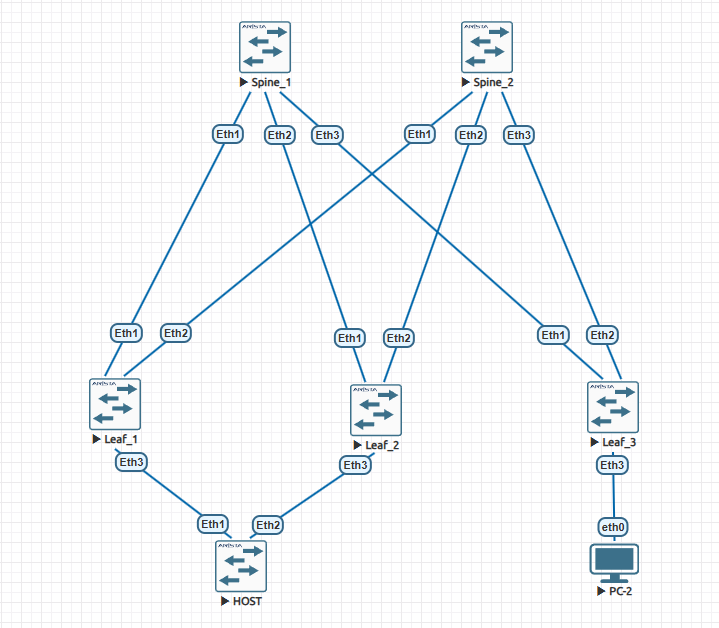
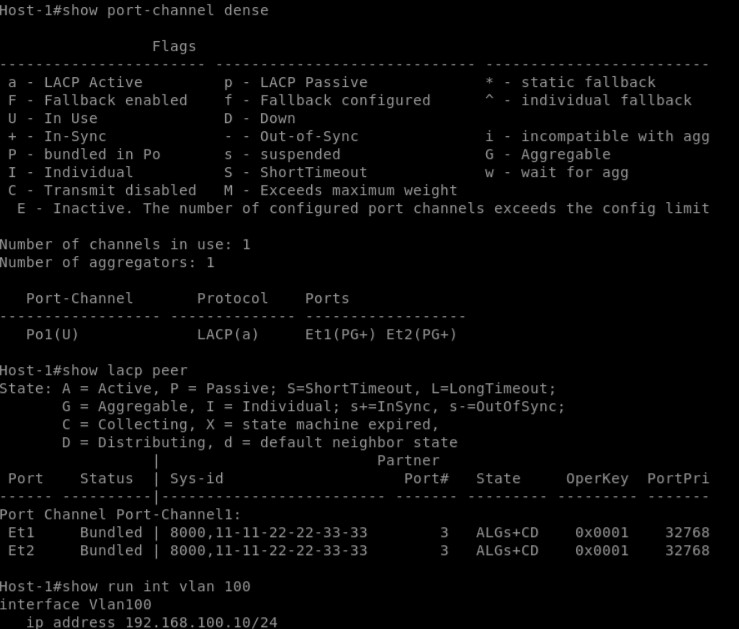
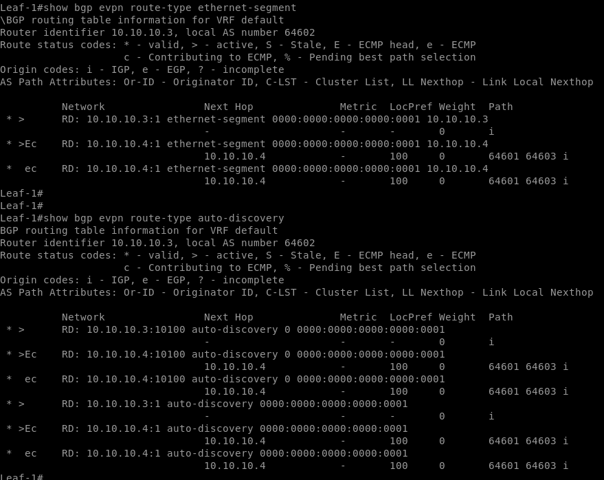
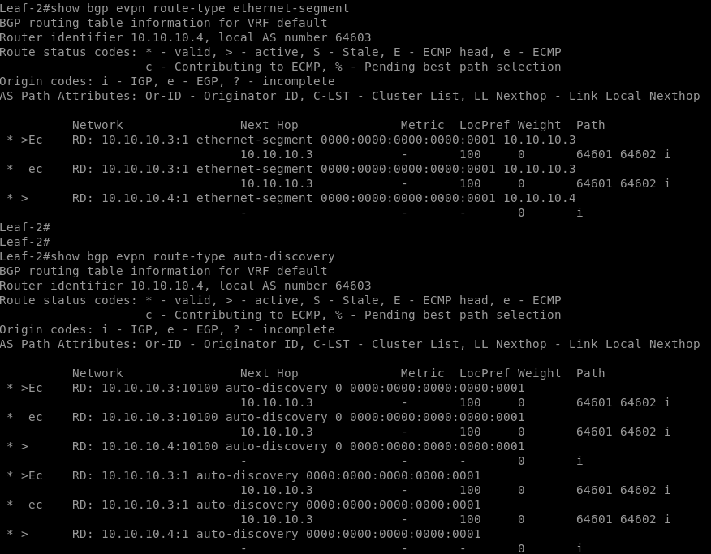
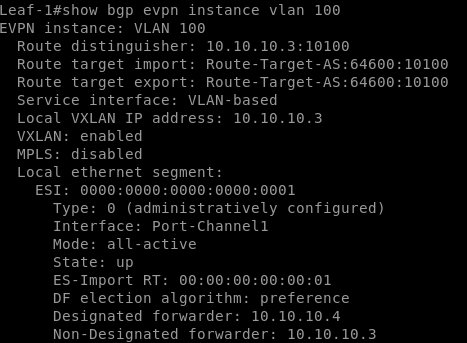
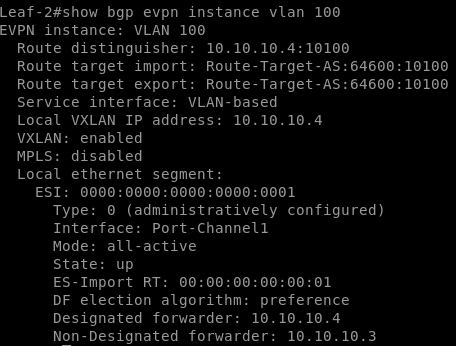
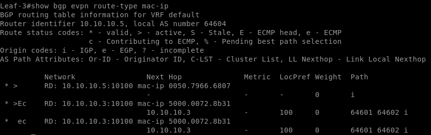
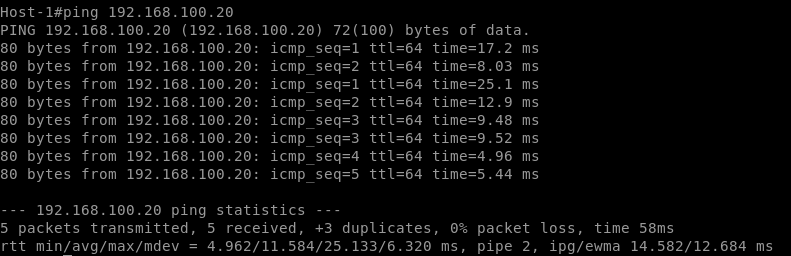

# Лабораторная работа №7 — VXLAN. EVPN Multihoming

## Цель работы

Построить сеть ЦОД с eBGP Underlay и EVPN/VXLAN Overlay, организовать подключение одного клиента к двум независимым Leaf через LACP и EVPN All-Active Multihoming (ESI-LAG), проверить работу управляющей плоскости и передачу пользовательского трафика.

## 1. Топология

Стенд построен в **EVE-NG** на **Arista vEOS-lab (EOS 4.33.1.1F)**. В состав сети входят два Spine, три Leaf, Host-1 (vEOS) и PC-2 (VPCS). Каждый Leaf подключён к обоим Spine. Host-1 подключён двумя физическими линками к Leaf-1 и Leaf-2, которые обслуживают общий Ethernet Segment. PC-2 подключён к Leaf-3.



### Адресное пространство и роли

| Устройство | ASN | Loopback / VTEP | Назначение |
|---|---:|---|---|
| Spine-1 | 64601 | 10.10.10.1/32 | eBGP Underlay, транзит EVPN |
| Spine-2 | 64601 | 10.10.10.2/32 | eBGP Underlay, транзит EVPN |
| Leaf-1 | 64602 | 10.10.10.3/32 | VTEP, участник ESI-LAG |
| Leaf-2 | 64603 | 10.10.10.4/32 | VTEP, участник ESI-LAG |
| Leaf-3 | 64604 | 10.10.10.5/32 | Удалённый VTEP, подключение PC-2 |
| Host-1 | — | 192.168.100.10/24 | Клиент LACP, VLAN 100 |
| PC-2 | — | 192.168.100.20/24 | Удалённый клиент, VLAN 100 |

| Соединение | Подсеть | IP Leaf | IP Spine |
|---|---|---|---|
| Leaf-1 — Spine-1 | 10.0.0.0/30 | 10.0.0.1 | 10.0.0.2 |
| Leaf-1 — Spine-2 | 10.0.0.4/30 | 10.0.0.5 | 10.0.0.6 |
| Leaf-2 — Spine-1 | 10.0.0.8/30 | 10.0.0.9 | 10.0.0.10 |
| Leaf-2 — Spine-2 | 10.0.0.12/30 | 10.0.0.13 | 10.0.0.14 |
| Leaf-3 — Spine-1 | 10.0.0.16/30 | 10.0.0.17 | 10.0.0.18 |
| Leaf-3 — Spine-2 | 10.0.0.20/30 | 10.0.0.21 | 10.0.0.22 |

Параметры сервиса: **VLAN 100**, **VNI 10100**, **EVPN Route Target 64600:10100**, **ESI 0000:0000:0000:0000:0001**.

## 2. Настройка eBGP Underlay

На интерфейсах Leaf–Spine настроены L3-адреса из подсетей `/30`. На каждом устройстве создан Loopback, который используется для BGP EVPN и в качестве VTEP на Leaf. IPv4-доступность Loopback обеспечена eBGP Underlay между Leaf и Spine; применены BFD, BGP timers 3/9 и ECMP.

На Leaf используется фильтрация анонсов connected-маршрутов: транзитные сети `10.0.0.0/24` не перераспределяются в BGP, остальные разрешённые connected-сети, в том числе Loopback, анонсируются:

```eos
ip prefix-list RM_FROM_CONNECTED seq 10 deny 10.0.0.0/24 le 32
ip prefix-list RM_FROM_CONNECTED seq 20 permit 0.0.0.0/0 le 32
!
route-map RM_FROM_CONNECTED_BGP permit 10
   match ip address prefix-list RM_FROM_CONNECTED
!
router bgp 64602
   address-family ipv4
      neighbor SPINE activate
      redistribute connected route-map RM_FROM_CONNECTED_BGP
```

На обоих Spine настроены BGP-соседства со всеми тремя Leaf. Конфигурации Underlay приведены в папке [`configs/`](configs/).

## 3. Настройка EVPN/VXLAN Overlay

Между Loopback-адресами Leaf и Spine настроены eBGP EVPN-соседства с `ebgp-multihop`, `update-source Loopback` и передачей Extended Communities. Spine распространяют EVPN-маршруты с сохранением NEXT_HOP (`neighbor EVPN-LEAF next-hop-unchanged`).

На каждом Leaf настроено соответствие **VLAN 100 → VNI 10100**, общий RT `64600:10100` и собственный RD:

```eos
interface Vxlan1
   vxlan source-interface Loopback1
   vxlan udp-port 4789
   vxlan vlan 100 vni 10100
!
router bgp 64602
   vlan 100
      rd 10.10.10.3:10100
      route-target both 64600:10100
      redistribute learned
   !
   address-family evpn
      neighbor EVPN-SPINE activate
```

Пример приведён для Leaf-1. На Leaf-2 и Leaf-3 используются их собственные адреса и ASN.

## 4. Настройка EVPN All-Active Multihoming

Host-1 подключён к **Ethernet3 Leaf-1** и **Ethernet3 Leaf-2**; на каждом Leaf создан `Port-Channel1` с активным LACP. На обоих Leaf заданы одинаковые значения ESI, ES-Import RT и LACP System ID, благодаря чему два независимых коммутатора обслуживают единый Ethernet Segment:

```eos
interface Port-Channel1
   description EVPN-MH-HOST1
   switchport trunk allowed vlan 100
   switchport mode trunk
   !
   evpn ethernet-segment
      identifier 0000:0000:0000:0000:0001
      designated-forwarder election algorithm preference 20
      route-target import 00:00:00:00:00:01
   lacp system-id 1111.2222.3333
!
interface Ethernet3
   description EVPN-MH-HOST1
   switchport mode trunk
   channel-group 1 mode active
```

На Leaf-2 используется `designated-forwarder election algorithm preference 50`, остальные параметры Ethernet Segment совпадают. Между Leaf-1 и Leaf-2 не требуется MLAG peer-link: взаимодействие участников Ethernet Segment обеспечивается BGP EVPN.

На стороне Host-1 настроен агрегированный канал из двух интерфейсов:

```eos
vlan 100
!
interface Port-Channel1
   switchport trunk allowed vlan 100
   switchport mode trunk
!
interface Ethernet1
   channel-group 1 mode active
!
interface Ethernet2
   channel-group 1 mode active
!
interface Vlan100
   ip address 192.168.100.10/24
!
no ip routing
```

На Leaf-3 PC-2 подключён к Ethernet3 в access VLAN 100. Для проверки L2-связности клиентам назначены адреса одной подсети `192.168.100.0/24`.

## 5. Проверка работы

### 5.1. LACP: два линка в одном Port-Channel

На Host-1 выполнены команды `show port-channel dense` и `show lacp peer`. В выводе `Po1(U)` объединяет `Et1(PG+)` и `Et2(PG+)`, оба линка синхронизированы и работают с единым LACP System ID `1111.2222.3333`.



### 5.2. EVPN Type-4 и Type-1

На обоих Leaf проверены команды:

```eos
show bgp evpn route-type ethernet-segment
show bgp evpn route-type auto-discovery
```

Маршруты **Type-4** подтверждают обнаружение двух участников общего ESI; маршруты **Type-1** содержат объявления Ethernet Auto-Discovery, в том числе Per-ES и Per-EVI.

**Leaf-1:**



**Leaf-2:**



### 5.3. Состояние Ethernet Segment и DF Election

Команда `show bgp evpn instance vlan 100` на обоих Leaf показывает **Mode: all-active**, **State: up**, общий ESI `0000:0000:0000:0000:0001` и согласованный результат DF Election. По настроенным предпочтениям DF для VLAN 100 выбран **Leaf-2 (10.10.10.4)**, Non-DF — **Leaf-1 (10.10.10.3)**.





### 5.4. Обмен MAC-маршрутами и клиентский трафик

На Leaf-3 команда `show bgp evpn route-type mac-ip` подтверждает изучение MAC-адресов через EVPN Type-2, включая MAC Host-1 за удалённым VTEP:



На Host-1 проверена доступность PC-2 `192.168.100.20` по ICMP. Получены ответы на все 5 запросов, потери пакетов — **0%**:



## 6. Вывод

Построена фабрика из двух Spine и трёх Leaf с eBGP Underlay и EVPN/VXLAN Overlay. Настроено подключение Host-1 одновременно к двум независимым Leaf через LACP и общий Ethernet Segment в режиме **EVPN All-Active Multihoming**. Подтверждены агрегирование клиентских линков, обмен EVPN Type-1/Type-4, согласованный выбор DF, распространение MAC-маршрутов Type-2 и передача пользовательского трафика между Host-1 и PC-2 через VXLAN VNI 10100.

## Структура проекта

```text
Lab7_EVPN_Multihoming/
├── README.md
├── configs/
│   ├── Host1.txt
│   ├── leaf1.txt
│   ├── leaf2.txt
│   ├── leaf3.txt
│   ├── spine1.txt
│   └── spine2.txt
└── screenshots/
    ├── topology.png
    ├── HOST1_LACP.png
    ├── HOST1_ping_PC-2.png
    ├── Leaf1_BGP_EVPN.png
    ├── Leaf1_Vlan100.png
    ├── Leaf2_BGP_EVPN.png
    ├── Leaf2_Vlan100.png
    └── Leaf3_host1.png
```
