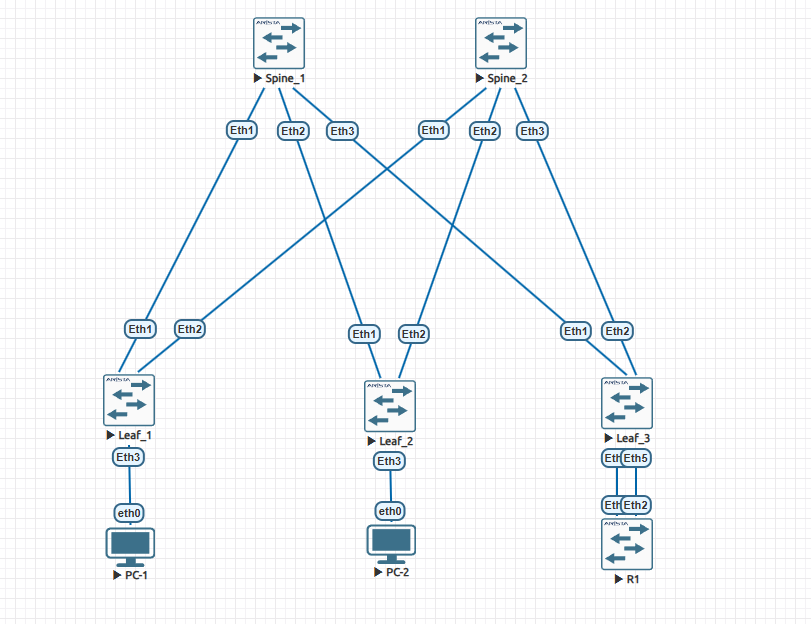
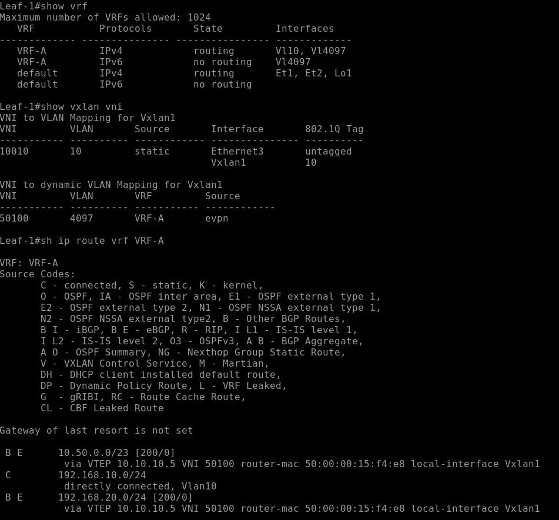
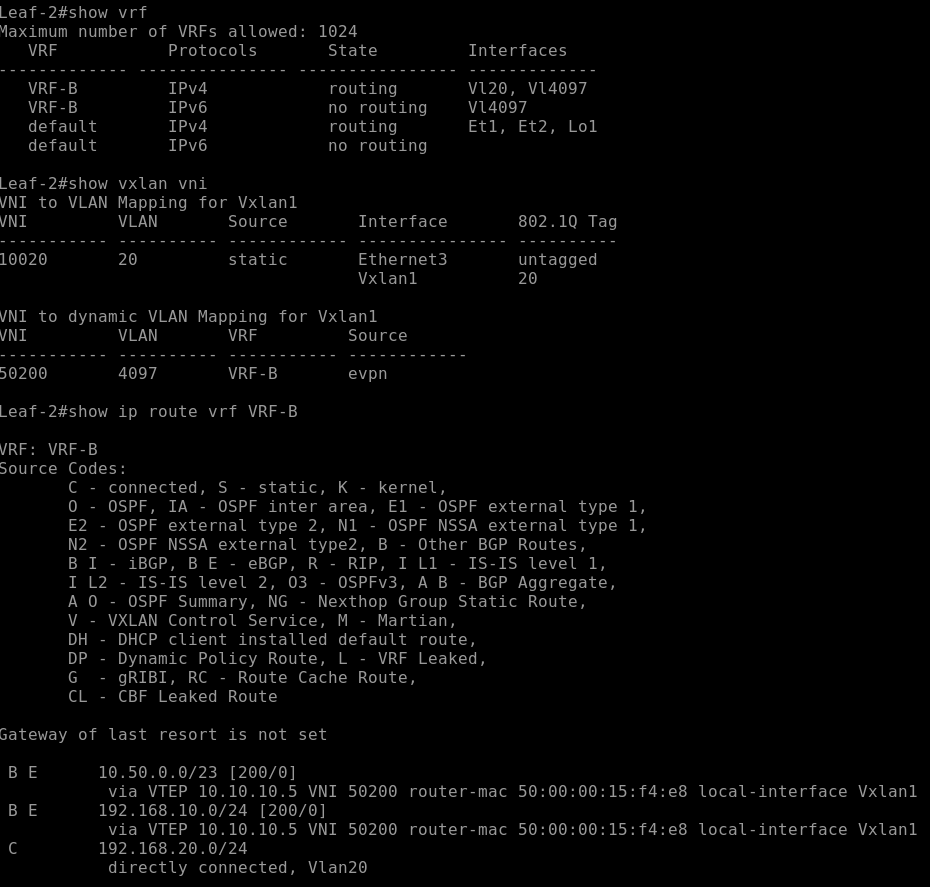
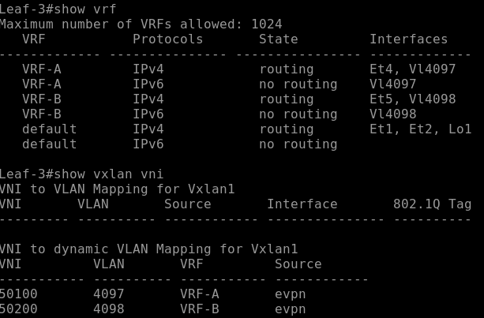
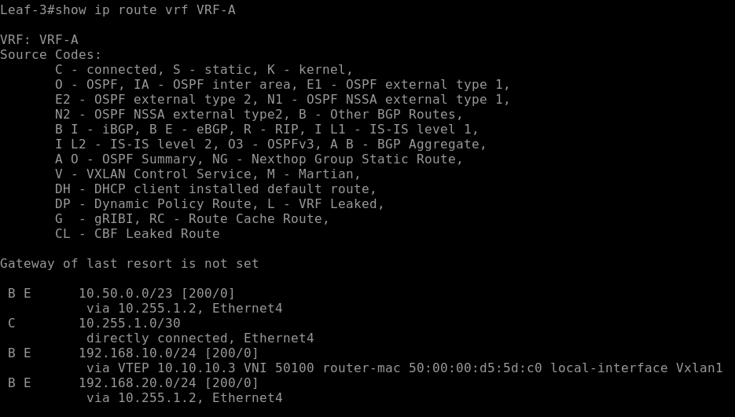
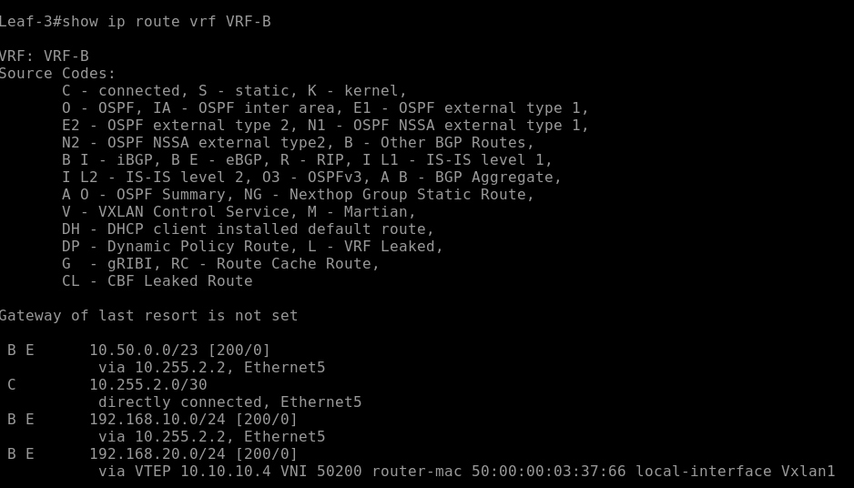
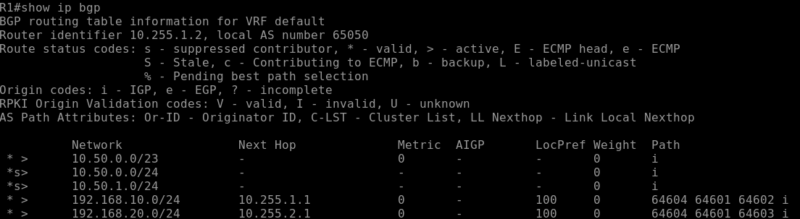
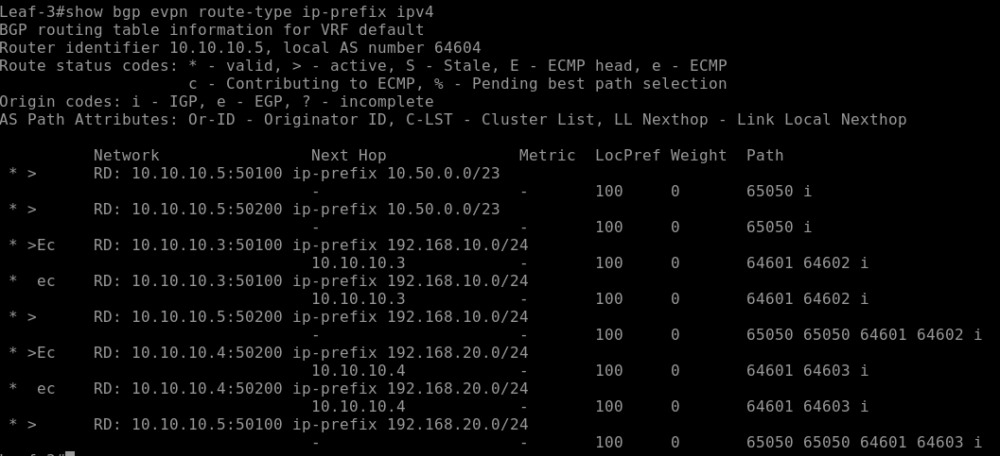
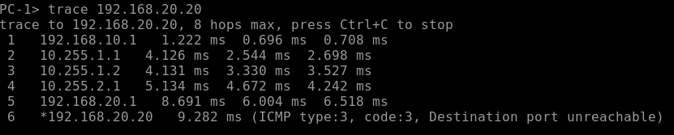

# Лабораторная работа №8 — VXLAN Routing / EVPN Type-5

## Цель

Построить сеть Spine–Leaf с EVPN/VXLAN, разместить двух клиентов в разных VRF, организовать маршрутизацию между ними **через внешний маршрутизатор** и реализовать передачу **суммарных IP-префиксов через EVPN Route Type-5**.

## Топология



Фабрика построена и настроена с нуля на **Arista vEOS-lab EOS 4.33.1.1F**: два Spine, три Leaf, внешний маршрутизатор R1 и два клиента VPCS.

| Устройство | Роль | AS | Loopback / VTEP |
|---|---|---|---|
| Spine-1 | Underlay и EVPN-транзит | 64601 | 10.10.10.1 |
| Spine-2 | Underlay и EVPN-транзит | 64601 | 10.10.10.2 |
| Leaf-1 | PC-1, VRF-A | 64602 | 10.10.10.3 |
| Leaf-2 | PC-2, VRF-B | 64603 | 10.10.10.4 |
| Leaf-3 | Border Leaf, VRF-A и VRF-B | 64604 | 10.10.10.5 |
| R1 | Внешняя маршрутизация и агрегация | 65050 | — |

### Адресация и сегментация

| Параметр | VRF-A | VRF-B |
|---|---|---|
| Клиент | PC-1: `192.168.10.10/24` | PC-2: `192.168.20.20/24` |
| Шлюз | `192.168.10.1` (Leaf-1) | `192.168.20.1` (Leaf-2) |
| VLAN / L2VNI | `10` / `10010` | `20` / `10020` |
| L3VNI | `50100` | `50200` |
| EVPN Route Target | `64600:50100` | `64600:50200` |
| Leaf-3 → R1 | `10.255.1.1/30` → `10.255.1.2/30` | `10.255.2.1/30` → `10.255.2.2/30` |

Полная underlay-адресация и назначение интерфейсов — в [конфигурациях](configs/).

## Ход работы

### 1. eBGP Underlay и EVPN Overlay

Настроены L3-соединения каждого Leaf с двумя Spine. В IPv4 Underlay используется eBGP, BFD, timers `3/9` и ECMP; для VTEP заданы Loopback-адреса `10.10.10.1`–`10.10.10.5`. Между Leaf и Spine настроен eBGP EVPN через Loopback (`ebgp-multihop 5`, extended communities). Spine сохраняют исходный EVPN next-hop, а Leaf используют VXLAN UDP 4789.

### 2. Изоляция двух клиентских VRF

На Leaf-1 настроены VRF-A, `Vlan10` и шлюз `192.168.10.1/24`; на Leaf-2 — VRF-B, `Vlan20` и шлюз `192.168.20.1/24`. Созданы L2VNI и L3VNI для symmetric IRB. На Leaf-3 настроены обе VRF, соответствующие L3VNI и импорт/экспорт EVPN по RT. Подключённые клиентские сети экспортируются в EVPN Type-5.

**Leaf-1: VRF-A, VLAN/VNI, маршруты**



**Leaf-2: VRF-B, VLAN/VNI, маршруты**



**Leaf-3: оба VRF и L3VNI**



### 3. Меж-VRF маршрутизация через внешний R1

Leaf-3 подключён к R1 по двум L3-линкам: `Ethernet4` в VRF-A и `Ethernet5` в VRF-B. Для каждой VRF настроено eBGP-соседство с R1 (AS 65050). R1 использует общую таблицу маршрутизации для обмена префиксами двух VRF. Для корректной передачи маршрутов через цепочку автономных систем применена настройка `as-path remote-as replace out` на внешнем R1 и на EVPN-соседствах Leaf-3.

В VRF-A на Leaf-3 маршрут к PC-1 приходит по VXLAN, а маршрут к PC-2 — от R1. В VRF-B — наоборот:





Путь меж-VRF-трафика:

```text
PC-1 → Leaf-1 (VRF-A) → VXLAN / L3VNI 50100 → Leaf-3
→ R1 → Leaf-3 (VRF-B) → VXLAN / L3VNI 50200 → Leaf-2 → PC-2
```

### 4. Агрегирование префиксов и экспорт в EVPN Type-5

На R1 созданы две тестовые подключённые сети: `10.50.0.0/24` (Loopback10) и `10.50.1.0/24` (Loopback11). Для сокращения числа анонсов настроено:

```eos
router bgp 65050
   network 10.50.0.0/24
   network 10.50.1.0/24
   aggregate-address 10.50.0.0/23 summary-only
```

В BGP R1 образован агрегат `10.50.0.0/23`, а составляющие `/24` помечены `s` (*suppressed*) и не анонсируются соседям.



Leaf-3 принимает `/23` от R1 в обоих VRF и экспортирует два EVPN Type-5 маршрута с разными RD и RT:

| VRF | RD | Агрегированный IP-Prefix Route | RT |
|---|---|---|---|
| VRF-A | `10.10.10.5:50100` | `10.50.0.0/23` | `64600:50100` |
| VRF-B | `10.10.10.5:50200` | `10.50.0.0/23` | `64600:50200` |



На клиентских Leaf установлены суммарные маршруты через VTEP Border Leaf `10.10.10.5`: в VRF-A по L3VNI 50100, в VRF-B по L3VNI 50200. Отдельные префиксы `10.50.0.0/24` и `10.50.1.0/24` в этих VRF не требуются.

### 5. Проверка меж-VRF связности

С PC-1 выполнены ping и трассировка к PC-2. Успешная ICMP-связность подтверждена, а трассировка показывает прохождение через R1:

```text
1  192.168.10.1   Leaf-1 (VRF-A)
2  10.255.1.1     Leaf-3 (VRF-A)
3  10.255.1.2     R1
4  10.255.2.1     Leaf-3 (VRF-B)
5  192.168.20.1   Leaf-2 (VRF-B)
6  192.168.20.20  PC-2
```



Проверена доступность обеих Loopback-сетей R1 через один суммарный маршрут `10.50.0.0/23`.

## Результат

Создана EVPN/VXLAN-фабрика с двумя независимыми VRF, реализована маршрутизация между клиентами через внешний R1 и передача агрегированного префикса через **EVPN Route Type-5**. Таблицы VRF, BGP и трассировка подтверждают работу выбранной схемы.

## Конфигурации

- [Spine-1](configs/Spine1.txt), [Spine-2](configs/Spine2.txt)
- [Leaf-1](configs/Leaf1.txt), [Leaf-2](configs/Leaf2.txt), [Leaf-3](configs/Leaf3.txt)
- [R1](configs/R1.txt)

